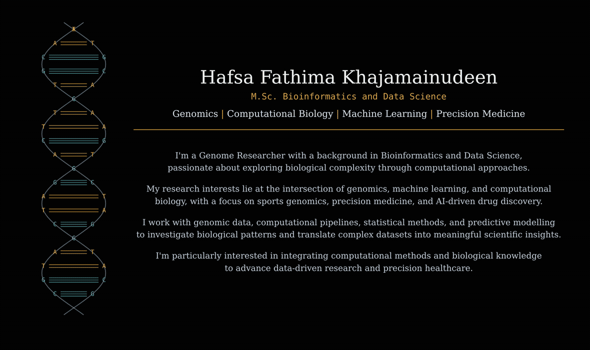
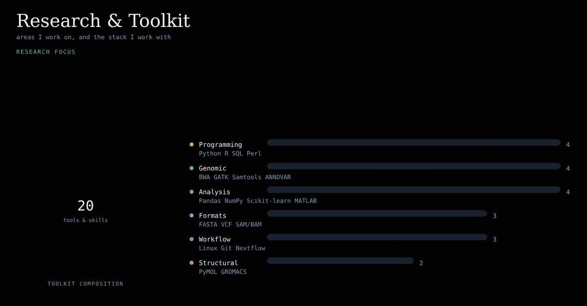
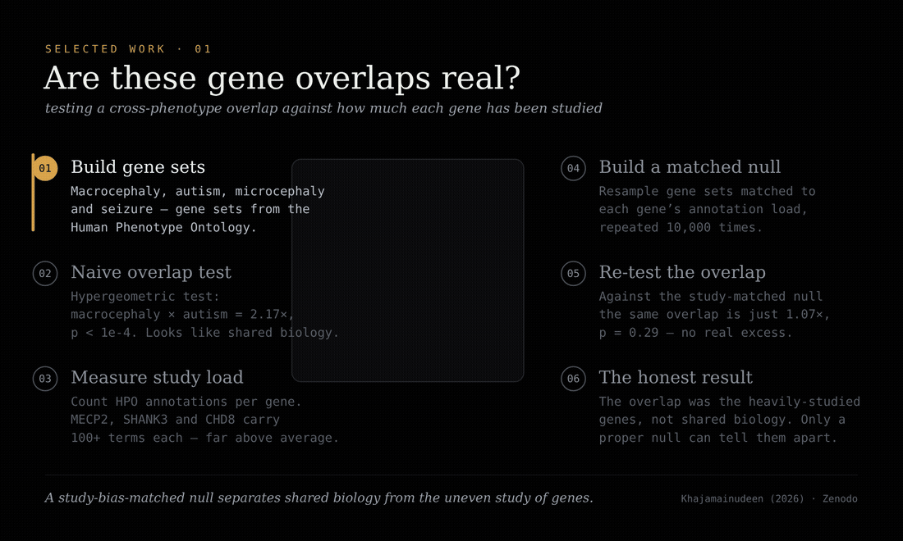
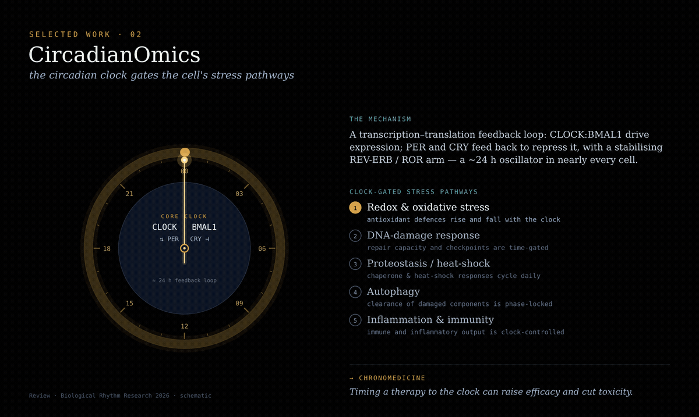
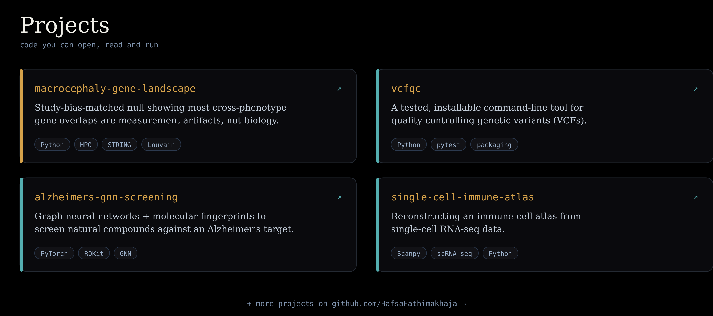

<!-- ============================================================
  Hafsa Fathima Khajamainudeen — GitHub profile README
  Repo: HafsaFathimakhaja/HafsaFathimakhaja  (special profile repo)
  Images live in /assets. Links marked TODO must be filled in.
============================================================ -->

<!-- ---------- HEADER ---------- -->

 

<!-- ---------- RESEARCH & TOOLKIT ---------- -->

 

<!-- ---------- SELECTED WORK ---------- -->
## 🔬 Selected Work

 

 

<!-- ---------- PROJECTS ---------- -->
## 🧩 Projects

<!--
  "Both": the card image above is the styled view; GitHub also shows your PINNED
  repositories automatically BELOW this README. To set those:
  Profile → "Customize your pins" → tick the same repos.
  TODO: only macrocephaly-gene-landscape is confirmed public. Create/rename/make-public
  (or remove) these before relying on them: vcfqc, alzheimers-gnn-screening, single-cell-immune-atlas.
-->

 

<!-- ---------- PUBLICATIONS ---------- -->
## 📄 Publications

  
  &nbsp;
  <!-- TODO: replace with the exact DOI/journal link when you have it; points to Scholar for now -->
  
  &nbsp;
  <!-- TODO: replace with the IEEE Xplore / DOI link when you have it; points to Scholar for now -->
  

 

<!-- ---------- CONNECT ---------- -->
## 🤝 Connect

  
  &nbsp;
  <!-- TODO: paste your LinkedIn profile URL -->
  
  &nbsp;
  
  &nbsp;
  
  &nbsp;
  

<!-- ============================================================
  BEFORE IT'S DONE — fill these in (search for "TODO" above):
  1. LinkedIn URL  → replace YOUR_LINKEDIN_URL_HERE
  2. Circadian review link (optional) → replace the Scholar link on that badge
  3. IEEE MeMeA link (optional) → replace the Scholar link on that badge
  The preprint DOI, GitHub, Gmail, Scholar and ORCID links already work.
============================================================ -->
