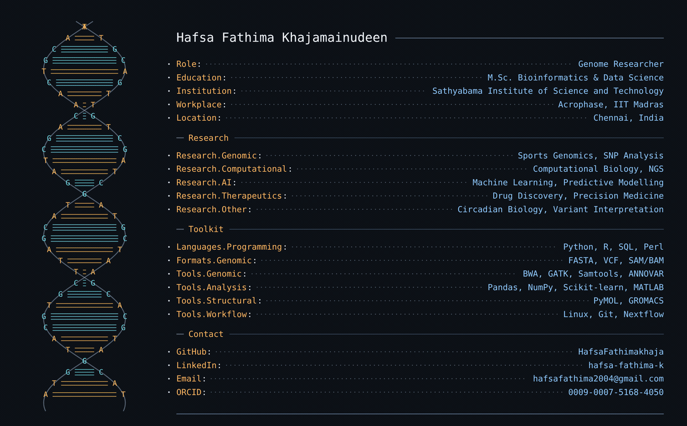
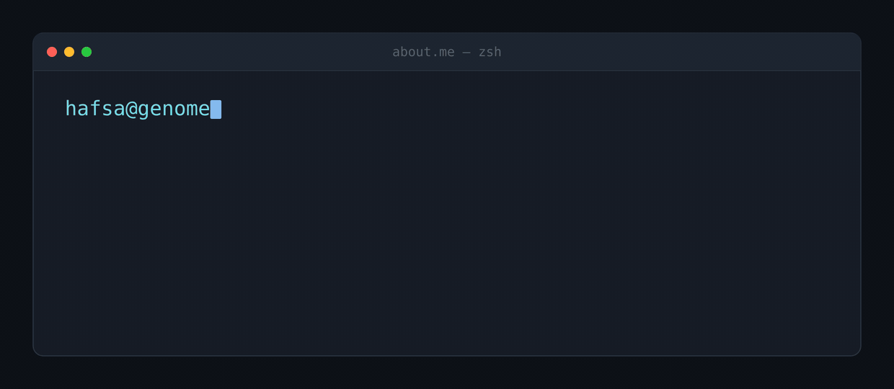
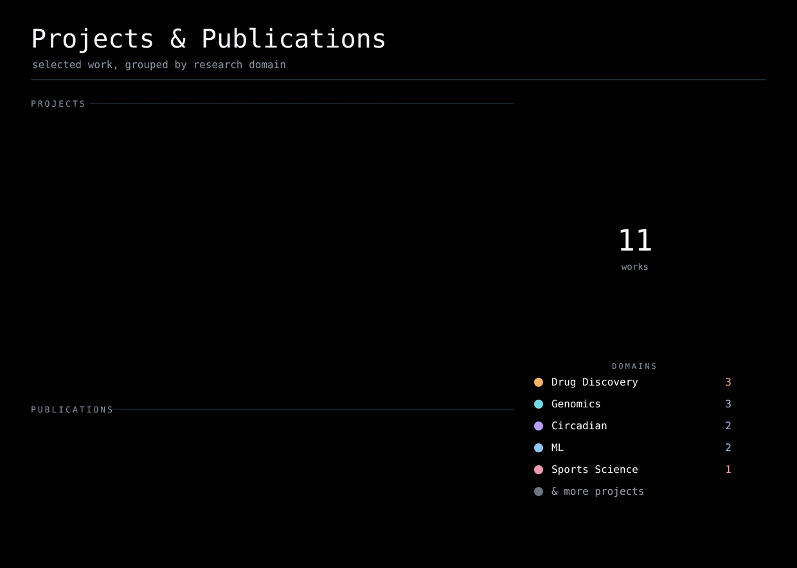

## Check out

- **ML Detection of Ventilatory Thresholds** — HR dynamics in CPET · *IEEE, 2026* — [Read&nbsp;↗](https://ieeexplore.ieee.org/document/11537357)
- **Beyond the Biological Clock** — Circadian control of cellular stress pathways · *Biological Rhythm Research (Taylor & Francis), 2026* — [Read&nbsp;↗](https://www.tandfonline.com/doi/full/10.1080/09291016.2026.2711231)
- **Study Bias Inflates Cross-Phenotype Gene Overlaps** — a macrocephaly case study · *Zenodo, 2026* — [DOI&nbsp;↗](https://doi.org/10.5281/zenodo.24124927)

## Connect

&nbsp;&nbsp;&nbsp;
&nbsp;&nbsp;&nbsp;
&nbsp;&nbsp;&nbsp;
&nbsp;&nbsp;&nbsp;

